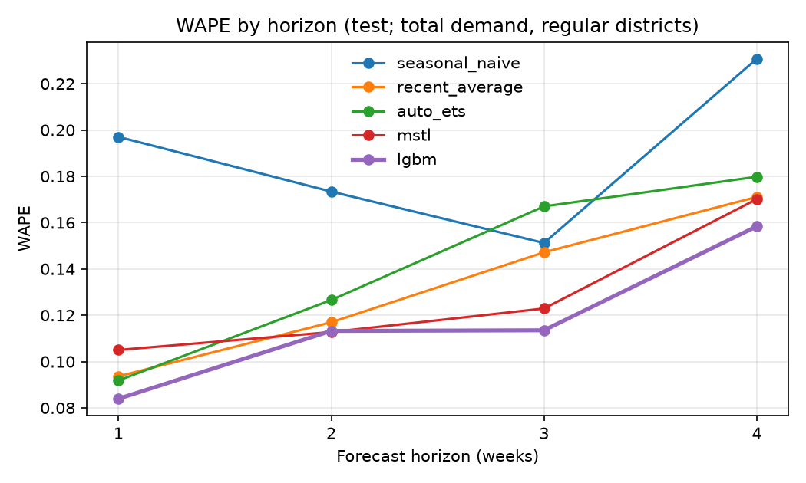
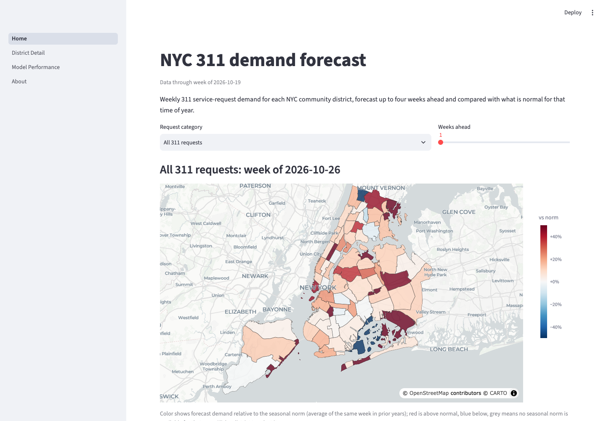
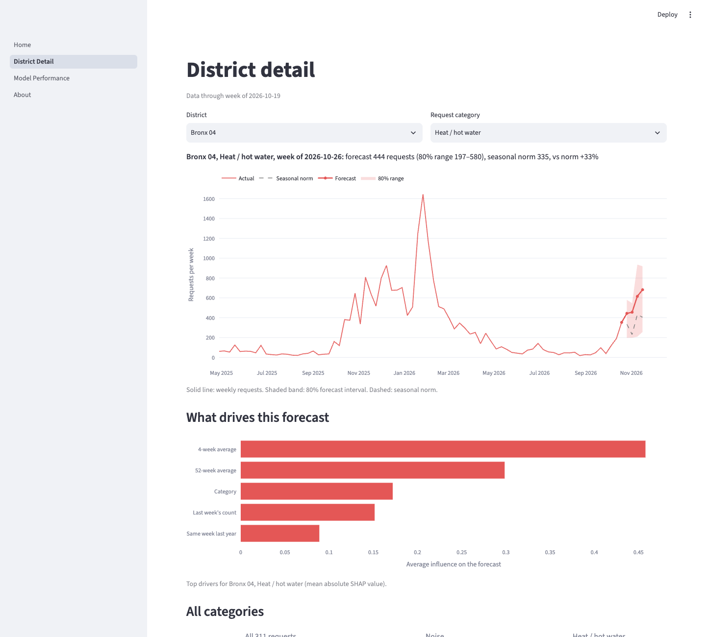
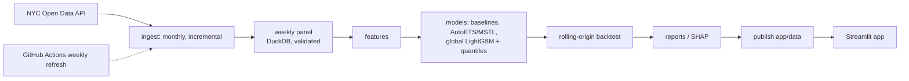
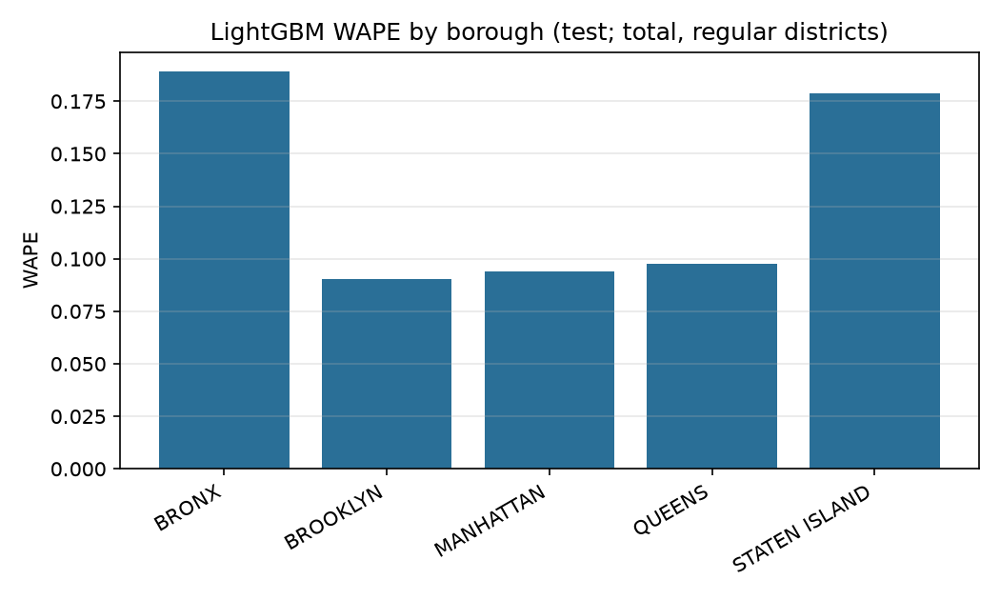
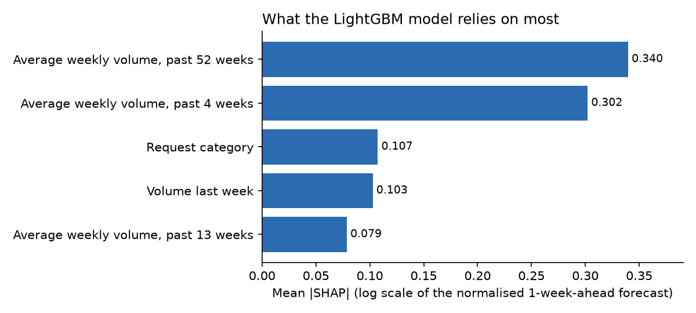

# NYC 311 Service Demand Forecasting

[](https://github.com/isabellaywshi/nyc311-demand-forecasting/actions/workflows/ci.yml)

Four-week-ahead forecasts of weekly 311 request volume for every NYC community district, with uncertainty bands, a surge flag against each district's seasonal norm, and an honest look at where the model is weaker.

**Live dashboard:** [nyc311-forecast.streamlit.app](https://nyc311-forecast.streamlit.app/)

## The problem

NYC agencies staff for 311 demand that varies by neighborhood, request type and season. A district that is about to see far more heat and hot water complaints than usual needs attention before the calls arrive, not after. This project forecasts weekly request counts for 59 regular community districts (plus 12 special areas such as parks) across five request categories and the total, one to four weeks ahead, and flags districts expected to run well above their norm.

The data is NYC Open Data's 311 Service Requests, refreshed weekly (Tuesdays 18:00 UTC) by a scheduled GitHub Actions job.

## Results

All numbers below are from the held-out test period: 12 forecast origins, every 4 weeks from 2025-11-03. A 13th origin was dropped because its 4-week window runs past the last complete week. Each model is refit at every origin using only data up to that origin. The headline slice is total demand across the 59 regular districts, horizons 1 to 4 weeks pooled.

| model | WAPE | MASE | P10-P90 coverage | mean interval width |
|---|---|---|---|---|
| seasonal_naive | 0.1889 | 1.0000 | n/a | n/a |
| recent_average | 0.1325 | 0.7013 | n/a | n/a |
| auto_ets | 0.1415 | 0.7488 | 0.8418 | 601.9543 |
| mstl | 0.1282 | 0.6786 | 0.7835 | 465.3751 |
| **lgbm** | **0.1177** | **0.6231** | 0.8086 | 418.6240 |

WAPE is total absolute error divided by total actual demand (lower is better). MASE scales error by the seasonal-naive forecast's error, so 1.0 means "no better than last year's same week". The global LightGBM model beats both baselines and both statistical models on WAPE and MASE, and its P10-P90 interval covers 80.9% of actuals against a nominal 80%. The model's hyperparameters were tuned on a separate validation period; the best grid setting scored a validation WAPE of 0.1166 (`validation_grid.csv`). The `reports/validation_*` tables were produced with the default LightGBM parameters before tuning; the tuned validation score is in `reports/validation_grid.csv`.

Accuracy falls as the horizon grows:

| horizon (weeks) | LightGBM WAPE | LightGBM coverage |
|---|---|---|
| 1 | 0.0839 | 0.8475 |
| 2 | 0.1132 | 0.8277 |
| 3 | 0.1135 | 0.8093 |
| 4 | 0.1584 | 0.7500 |

Four-week intervals are too narrow (75.0% coverage). At horizon 2 MSTL is marginally ahead of LightGBM (0.1127 vs 0.1132).



The categories are harder than the total, because counts are smaller and noisier:

| category | LightGBM WAPE | seasonal_naive WAPE |
|---|---|---|
| illegal_parking | 0.1151 | 0.1796 |
| sanitation | 0.2208 | 0.2856 |
| noise | 0.2316 | 0.3908 |
| street_conditions | 0.2629 | 0.3782 |
| heat_hot_water | 0.3427 | 0.3755 |

LightGBM leads on every category. For heat and hot water, where volume swings with the heating season, the margin over seasonal naive is small (MASE 0.9128) and coverage is 0.7412.

**Surge alerts.** An alert fires when the forecast is at least 1.25 times the district's seasonal norm and the norm is at least 5 requests. On the test period (all categories, regular districts, horizons pooled):

| alert rule | precision | recall | F1 |
|---|---|---|---|
| LightGBM forecast | 0.6654 | 0.6697 | 0.6675 |
| recent-average rule | 0.6038 | 0.6392 | 0.6210 |

There were 6,076 actual surges (n_actual); the LightGBM rule raised 6,115 alerts. It is better than the simple rule on both measures, but about one alert in three is wrong and about one surge in three is missed.

## Dashboard



The home page maps each district's forecast against its seasonal norm, by request category and weeks ahead. The district page shows history, forecast, the 80% range, the norm, and the features driving that forecast.



## Approach



**Data.** The pipeline pulls daily counts by community board and complaint type, aggregates them to Monday-start weeks for 71 areas by 6 targets, and fails if the panel has gaps, duplicates or negative counts, or if its totals drift more than 1% from an independently pulled citywide count.

**Models.** Two naive baselines (same week last year; mean of the last 4 weeks), two per-series statistical models (AutoETS, MSTL with 52-week seasonality), and one global LightGBM model per horizon. LightGBM trains on all series at once, with each series scaled by its trailing 52-week mean. Its features are lags, rolling means and spreads, the same week last year, week-of-year and month, holidays, a COVID flag and the area and category. P10 and P90 come from separate quantile models.

**Backtest.** Rolling origin: at each origin every model trains only on earlier data and forecasts weeks 1 to 4. Validation and test periods are disjoint, and hyperparameters were tuned on validation only. A unit test checks that features at an origin do not change when later data is altered.

## Equity check

Does forecast quality hold up across boroughs? Test WAPE for LightGBM, total demand, regular districts, horizons pooled:

| borough | LightGBM WAPE | seasonal_naive WAPE | coverage |
|---|---|---|---|
| BROOKLYN | 0.0904 | 0.1578 | 0.8206 |
| MANHATTAN | 0.0941 | 0.1297 | 0.8038 |
| QUEENS | 0.0978 | 0.1645 | 0.7783 |
| STATEN ISLAND | 0.1789 | 0.2139 | 0.8472 |
| BRONX | 0.1890 | 0.3097 | 0.8212 |

The model is not equally accurate everywhere. The Bronx (0.1890) has about twice the error of Brooklyn (0.0904), and Staten Island (0.1789) is close behind. Staten Island has only three districts, so its figure rests on little data. The Bronx is the larger concern: any use of these forecasts for staffing should treat Bronx and Staten Island predictions with wider margins. LightGBM does beat the seasonal baseline in all five boroughs, by the widest margin in the Bronx. A WAPE gap does not tell us why; differences in volume level, reporting habits and year-to-year change could all contribute.



## What drives demand



Mean absolute SHAP values for the one-week-ahead LightGBM model (fit on data through 2026-10-19; the live app updates weekly) are in log scale of the normalised forecast, because the model uses a Tweedie log link. They show that the forecast is mostly driven by a district's own recent history: the 52-week average (0.340) and 4-week average (0.302) are well ahead of the next feature, request category (0.107). Only the top five features are shown. This is a statement about what the model uses, not about causes.

## Limitations and future work

- **Reporting is not need.** 311 counts measure who calls, not who needs service. Use of 311 is uneven across neighborhoods, so a low count may reflect low reporting.
- **Surge flags are relative to a norm built from prior years.** If a district has been growing, the norm lags and surges are over-counted. About a third of series-weeks in the test period (6,076 of 16,992) were flagged as actual surges, so "surge" here means "above a lagging seasonal norm", not "unusual".
- **No weather inputs.** Heat and hot water and noise are weather-sensitive, and heat and hot water is the weakest category (WAPE 0.3427).
- **Small test sample.** The test period has 12 forecast origins over one year, so the figures above carry real sampling uncertainty.
- **Four-week intervals are too narrow** (75.0% coverage vs 80% nominal).
- **Future work:** weather covariates; deep-learning models as a comparison; an orchestrator such as Airflow (an idea only; scheduling today is a GitHub Actions cron job); tuning the alert threshold, which is currently a fixed 1.25 times the norm.

## Reproduce

Requires Python 3.12 and [uv](https://docs.astral.sh/uv/).

```bash
brew install uv libomp        # macOS; libomp is needed by LightGBM
uv sync
```

Create a `.env` file with a free Socrata app token (data.cityofnewyork.us, Developer Settings):

```
SOCRATA_APP_TOKEN=your_token_here
```

```bash
uv run nyc311 refresh                       # ingest, panel, train, forecast, publish
uv run nyc311 backtest --period validation  # rolling-origin validation backtest
uv run nyc311 evaluate-test                 # final test evaluation: run ONCE
uv run streamlit run app/Home.py            # dashboard
uv run pytest                               # tests
uv run python scripts/make_readme_figures.py  # regenerate the SHAP figure
```

On macOS, if `uv run nyc311` fails with `ModuleNotFoundError`, run `chflags nohidden .venv/lib/python3.12/site-packages/*.pth`.

`evaluate-test` is meant to run once: it refuses if `reports/test_overall.csv` exists unless `--force`. After new data arrives, a forced re-run would add forecast origins and change the reported numbers.

Report tables and figures in `reports/` come from the backtest and test evaluation commands; the numbers in this README are copied from `reports/test_*.md` and `reports/validation_grid.csv`.

## Data source

NYC Open Data, [311 Service Requests from 2020 to Present](https://data.cityofnewyork.us/Social-Services/311-Service-Requests-from-2020-to-Present/erm2-nwe9) (dataset `erm2-nwe9`). Use is subject to the [NYC Open Data Terms of Use](https://www.nyc.gov/html/data/terms.html). Community district boundaries are from NYC Department of City Planning.

## License

Code is released under the [MIT License](LICENSE). The 311 data belongs to the City of New York and is used under the NYC Open Data terms of use.
